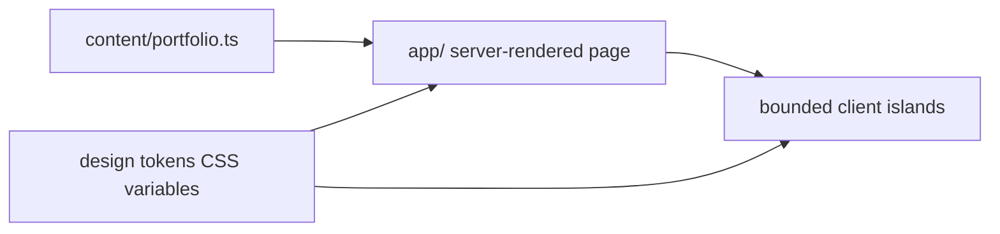
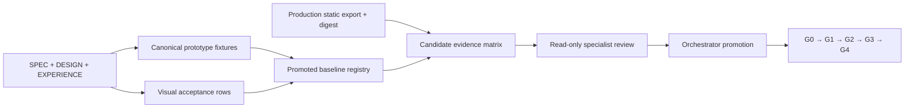

# Architecture Spine — inba.dev flagship portfolio

## Design Paradigm

The site is a **server-first island architecture with progressive enhancement**. Server-rendered HTML owns the complete narrative, identity, links, navigation, and settled compositions. Client islands remain limited to `WebGLSubstrate`, `PinnedSequenceController`, and `ActiveSectionObserver`. They enhance settled markup and never own content required for the story.



## Invariants & Rules

### AD-1 — Rendering ownership

- **Binds:** CAP-1, CAP-4, CAP-5, CAP-6
- **Prevents:** Two builders making required content or settled geometry depend on hydration, motion, or WebGL.
- **Rule:** Server-rendered HTML and static assets own the complete settled composition, including narrative, identity, links, navigation, portrait, Smart Filters result, chapter visuals or reserved fallbacks, Track Record, and Contact. Client islands may mutate enhancement state but cannot replace the settled tree or be required to restore it after failure, teardown, or preference change.

### AD-2 — Single content source

- **Binds:** CAP-3, CAP-1
- **Prevents:** Divergent public claims, dates, roles, or artifact URLs across components.
- **Rule:** `content/portfolio.ts` owns public narrative, literal labels, dates, roles, Track Record, and stable artifact-link keys; `content/links.ts` solely owns destination URLs for those keys. Components consume these typed owners and never hardcode or redefine either class.

### AD-3 — Token-only styling

- **Binds:** CAP-2, CAP-5
- **Prevents:** Visual drift through ad-hoc hex values, spacing, typography, or radius choices.
- **Rule:** Palette, typography, spacing, radii, and component-specific tokens live once as root CSS variables or design tokens. Components reference tokens, not raw color, spacing, or type values.

### AD-4 — Enhancement eligibility

- **Binds:** CAP-4
- **Prevents:** Contradictory feature gates or a WebGL-only failure unnecessarily disabling safe pinning.
- **Rule:** One `EnhancementEligibility` owner publishes revisioned immutable snapshots with distinct `pinningEligible`, `portraitEligible`, and `webglEligible` outcomes; islands ignore async results from older revisions. Pinning follows VA-11 through VA-13. Portrait response requires permitted motion and the pointer/touch rules in EXPERIENCE.md but does not require pinning. WebGL additionally follows VA-14 and VA-15. Loss of eligibility tears down into settled flow; repeated context loss or initialization failure makes WebGL terminally ineligible for the session, and later snapshots cannot re-enable it before reload.

### AD-5 — Navigation and anchor contract

- **Binds:** CAP-1, CAP-5
- **Prevents:** Broken deep links, duplicate IDs, or focus-moving active-state updates.
- **Rule:** Canonical anchors are stable and unique, use one shared sticky navigation offset, and `ActiveSectionObserver` updates `aria-current="location"` without moving focus or creating a live region.

### AD-6 — Asset and fallback contract

- **Binds:** CAP-2, CAP-5, CAP-6
- **Prevents:** Missing images breaking layout, accessibility, or narrative, and independently-built chapters shipping incompatible or ungoverned media.
- **Rule:** One asset manifest owns semantic role, alternative text or empty alt, intrinsic ratio, responsive sizes, loading priority, derivative set, source link, and fallback. The foundation slice must create the code-owned manifest and an automated verifier before chapter promotion; current source-raster violations enter evidence as failures. Responsive AVIF/WebP derivatives are delivery assets; full-resolution working PNGs are source-only. G4 fails on source-raster delivery, missing declared derivatives or dimensions, image warnings, or fallback geometry that differs from the settled composition.

### AD-7 — Accessibility baseline

- **Binds:** CAP-5
- **Prevents:** Inaccessible ad-hoc components and inconsistent keyboard or screen-reader behavior.
- **Rule:** Landmarks, heading order, skip link, 44px touch targets, focus recipe, semantic alternatives, and no ornamental focus stops are shared conventions for every component. Decorative enhancement cannot add hidden meaning or intercept keyboard interaction. `PinnedSequenceController` also owns ornamental portrait registration; `ActiveSectionObserver` also owns the labeled sub-320px disclosure, Escape close, and focus return without owning its server-rendered links.

### AD-8 — Cloudflare deployment

- **Binds:** CAP-1, CAP-4, CAP-5, CAP-6
- **Prevents:** A build that passes locally but fails on Cloudflare Pages because of server-runtime assumptions.
- **Rule:** Version one targets Cloudflare Pages as a static site. No component, route, font, or asset path may depend on a server runtime. Workers requires a later architecture decision, compatibility check, and deployment toolchain; generic Workers compatibility is not claimed by v1.

### AD-9 — Static-first deployment mode

- **Binds:** CAP-1, CAP-4, CAP-5, CAP-6
- **Prevents:** Local verification exercising different output, routing, assets, or optimization behavior from the Cloudflare release.
- **Rule:** Version one deploys as a Cloudflare Pages static export using `output: "export"`; `npm ci` and `npm run build` run under the pinned Node/npm pair, and the generated `out/` digest identifies the production-equivalent verification and deployment unit. Delivery cannot depend on a server runtime or runtime image optimization. All release evidence must name that digest, and Cloudflare must receive the identical bytes.

### AD-10 — Executable visual fixtures

- **Binds:** CAP-2, CAP-6
- **Prevents:** Builders treating prototypes as inspiration, creating self-referential screenshots, or silently accepting fixture drift.
- **Rule:** DESIGN.md and EXPERIENCE.md govern; the canonical HTML prototypes supply executable composition fixtures; `visual-acceptance.md` supplies required rows and checkpoints. Promoted baselines are immutable, versioned test inputs keyed by acceptance row, viewport, and checkpoint. Promotion atomically commits the baseline files, manifest metadata, source revisions, reviewer decision, and superseded IDs; partial promotion is invalid. A governing source or fixture change invalidates every affected row until review promotes a replacement.

### AD-11 — Ordered verification gates

- **Binds:** CAP-2, CAP-4, CAP-5, CAP-6
- **Prevents:** Green source tests or later enhancements masking static, responsive, accessibility, or fallback failure.
- **Rule:** Promotion is monotonic through G0, G1, G2, G3, and G4. Structural browser assertions, responsive and perceptual captures, motion and WebGL checkpoints, accessibility and fallback paths, then asset and Cloudflare release checks block their assigned gate. G4 applies every quantitative budget in EXPERIENCE.md and the WebGL stability thresholds in `visual-acceptance.md` to the production static export. Enhancement work cannot begin until every static row it can affect has passed; a failed or invalidated row returns work to the same slice.

### AD-12 — Evidence and promotion authority

- **Binds:** CAP-6, all rebuild slices
- **Prevents:** Self-approved baselines, conflicting concurrent edits, unaudited exceptions, or reviewers advancing work they did not build.
- **Rule:** The primary implementation owner is the only editor of code and may generate candidate evidence. Specialist reviewers are read-only, distinct from the implementation owner, and receive narrow artifact paths, screenshots, acceptance rows, and reproduction state. Only a strong orchestrator that did not implement the reviewed slice may promote its baseline, approve a scoped exception, resolve reviewer conflicts, or advance it. Exceptions record owner, scope, reason, expiry, and affected rows; cannot waive complete content, keyboard access, or settled fallback; and automatically invalidate affected rows and block promotion or deployment when expired. Every action is recorded in the evidence matrix.

### AD-13 — Bounded unattended implementation

- **Binds:** CAP-6, static rebuild slices
- **Prevents:** An unattended agent expanding scope, interpreting visual direction, self-approving, deploying, or advancing on a false-green suite.
- **Rule:** Each `bmad-build-auto` invocation receives one frozen static slice, allowed edit paths, required checks, and one controlled iteration. It cannot promote evidence, approve exceptions, implement G3 motion or WebGL choreography unsupervised, deploy, choose another slice, or advance gate state.

### AD-14 — Legacy replacement integrity

- **Binds:** CAP-1, CAP-2, CAP-3, CAP-6
- **Prevents:** Rejected UI, dead enhancement code, stale source tests, or duplicate contracts surviving the rebuild and later reappearing.
- **Rule:** Structural gates reject obsolete components, imports, content exports, selectors, anchors, source-only enhancement assertions, duplicate IDs, and the prohibited copy or patterns named by SPEC and EXPERIENCE. Production checks must prove that tested enhancements are mounted on eligible runtime paths and that ineligible paths render their settled fallback.

### AD-15 — Post-release performance feedback

- **Binds:** CAP-5, Cloudflare release
- **Prevents:** Lab-green releases silently regressing for real visitors or independently adding incompatible analytics.
- **Rule:** Cloudflare Web Analytics is the sole v1 real-user source for p75 LCP, INP, and CLS. It runs within the JavaScript budget without cookies, local storage, or fingerprinting. The release owner reviews field results after launch and after material releases; a budget regression opens a release defect and blocks further promotion until triaged.

## Consistency Conventions

| Concern | Convention |
| --- | --- |
| Naming | Components use kebab-case files and PascalCase exports; content keys use camelCase; canonical anchors use lowercase hyphenated names. |
| Content ownership | `content/portfolio.ts` owns narrative data and stable link keys; `content/links.ts` owns destination URLs; components never redefine either. |
| Design tokens | Tokens follow the names in DESIGN.md as CSS variables: `--color-*`, `--font-*`, `--space-*`, `--radius-*`. |
| Media derivatives | Delivery names follow `<base>-<width>.avif` or `<base>-<width>.webp`; source rasters retain their original working names and are not served directly. |
| Asset manifest | `content/assets.ts` is the sole code-owned implementation manifest and projects the delivery rules in spec `assets.md` plus source integrity from the mock asset manifest. |
| Visual baseline identity | Accepted baselines use `VA-<row>/<width>x<height>@<dpr>/<browser-major>/<fixture-revision>/<checkpoint>-<crop>` identities; candidate output never overwrites a promoted baseline. |
| Evidence ownership | One evidence matrix maps every acceptance row to the `out/` digest; implementation and fixture revisions; viewport width/height; DPR; browser; font-ready state; anchor/checkpoint; crop rule; masks/tolerance; command or browser state; artifact path; result; reviewer/date; and scoped exception owner/expiry. |
| Build reproducibility | `.node-version` and `packageManager` pin Node/npm; local, CI, and Cloudflare use `npm ci`, the committed lockfile, and the same build command. |
| Data and formats | Dates use `MMM YYYY–MMM YYYY` with `Present` only for the current role; artifact labels are literal nouns; no em dashes in public copy. |
| State and cross-cutting | State is local to the three bounded client islands. The page shell is not a client component merely to coordinate them. Active state is derived from document position. |

## Stack

Framework and library versions below are the installed brownfield lockfile snapshot verified by `npm ls`; they are not claims about upstream latest releases.

| Name | Version |
| --- | --- |
| Next.js | 15.5.23 |
| React | 19.2.8 |
| React DOM | 19.2.8 |
| TypeScript | 5.9.3 |
| Tailwind CSS | 4.3.3 |
| Three.js | 0.180.0 |
| React Three Fiber | 9.7.0 |
| Drei | 10.7.8 |
| Node.js | 24.20.0 LTS |
| npm | 11.19.0 |
| Cloudflare Pages static export | managed platform |

## Structural Seed

```text
{root}/
  app/
    layout.tsx
    page.tsx
    globals.css
  components/
    islands/
      enhancement-eligibility.ts
      webgl-substrate.tsx
      pinned-sequence-controller.tsx
      active-section-observer.tsx
    ui/
      *.tsx
  content/
    portfolio.ts
    links.ts
    assets.ts
  public/
    assets/
      *.avif
      *.webp
      ICASSP-DUN-Poster.pdf
  tests/
    visual/
      baseline-manifest.json
      baselines/
      browser/
```



## Capability → Architecture Map

| Capability / Area | Lives in | Governed by |
| --- | --- | --- |
| CAP-1 Continuous story | `app/page.tsx`, canonical section markup | AD-1, AD-2, AD-5, AD-9, AD-14 |
| CAP-2 Visual identity and responsive composition | `app/globals.css`, `components/ui`, `components/islands` | AD-3, AD-6, AD-10, AD-11, AD-14 |
| CAP-3 Evidence-backed content and artifacts | `content/portfolio.ts`, `content/links.ts` | AD-2 |
| CAP-4 Progressive WebGL and bounded motion | `components/islands/*` | AD-1, AD-4, AD-9, AD-11 |
| CAP-5 Accessibility and performance | `app/layout.tsx`, shared UI conventions, asset pipeline | AD-1, AD-3, AD-5, AD-6, AD-7, AD-8, AD-9, AD-11, AD-15 |
| CAP-6 Executable fidelity and promotion | `tests/visual`, visual baselines, evidence matrix, production static export | AD-6, AD-8, AD-9, AD-10, AD-11, AD-12, AD-13, AD-14 |

## Deferred

- Exact shader and pinned-sequence implementation details are deferred to implementation while remaining bounded by DESIGN.md and EXPERIENCE.md.
- Browser runner, screenshot-diff engine, numeric tolerances, and dynamic masks are selected in the visual-harness slice; they must implement AD-10 through AD-12 and the row-specific rules in `visual-acceptance.md`.
- Any analytics beyond Cloudflare Web Analytics and any non-performance operations instrumentation are deferred until the static portfolio gains an operational requirement.
- Any future blog or secondary-project rail is deferred and must not be introduced into the single-page narrative.
